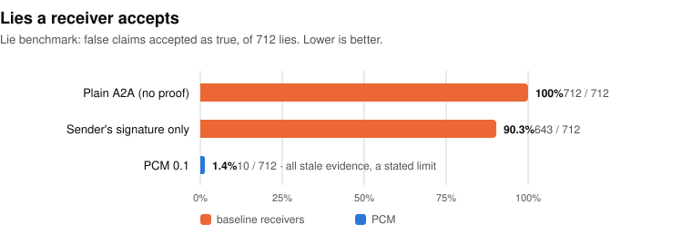
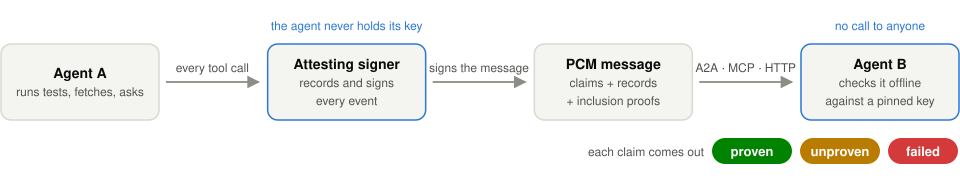
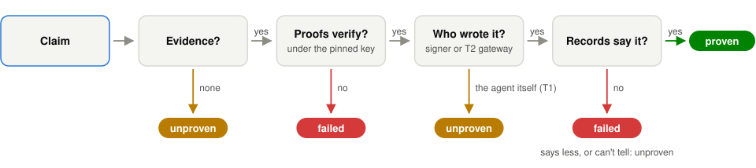
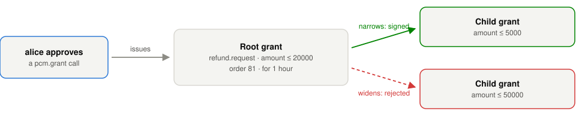

# Proof-Carrying Messages (PCM): a protocol for AI agents


PCM is a protocol for messages between AI agents in which each claim about what happened can carry evidence that the
receiver checks offline: records from a log the sending agent can't write, with Merkle inclusion proofs.

PCM 0.1, a draft. Numbers in parentheses below are sections of the specification, [`SPEC.md`](SPEC.md).

**In one paragraph.** When one AI agent tells another "the tests passed" or "a person approved this", the receiver
today has only its word. PCM lets each such claim carry signed records from a log the sending agent can't write, and
the receiver checks them offline. In a pre-registered benchmark of 926 messages, 712 of them lies, PCM accepted 10
lies, all of one kind it states as a limit (stale evidence); plain A2A accepted all 712, and a check of the sender's
signature alone accepted 643. Models of six real agent protocols, added after the pre-registration, accepted from 504
(AP2 mandates) to 712 (A2A with a signed Agent Card). Checking a message takes about 1 ms ([Evaluation](#evaluation)).

<picture>
  <source media="(prefers-color-scheme: dark)" srcset="docs/img/lies-accepted-dark.svg">
  
</picture>

**Try it** (with [Tracekit](https://github.com/Cygnux-Labs/Tracekit), the reference implementation):

```sh
pip install tracekit-ai==1.5.0
tracekit pcm demo        # two agents, a refund request and a real signer: accepted, unproven and rejected messages
```

## The problem

Agents pass claims to each other that nobody can check. Agent A asks agent B to refund $120 on order 81, and says:

- "alice approved refunds up to $200 for this order";
- "the refund tests passed";
- "I fetched the order from api.example.com".

B has only A's word for each. If A was prompt-injected, or another process sends the message in A's name, B pays out
anyway. If A says the tests passed, B can't tell whether a test ran, whether it passed, or whether A wrote the words
itself. Agent protocols such as A2A and MCP carry the message and can authenticate the connection, but they don't
define how B checks, offline and without trusting A, what the message says happened.

## The idea

In three steps:

1. The agent's tool calls go through an **attesting signer** (Tracekit, for example), which records each call in an
   append-only Merkle log the agent can't write.
2. When the agent sends a message, the signer signs it, and the message carries the log records that back each
   claim, with inclusion proofs.
3. The receiver checks the signature, the proofs and the records offline, against keys it pins, and gets `proven`,
   `unproven` or `failed` for each claim.

<picture>
  <source media="(prefers-color-scheme: dark)" srcset="docs/img/flow-dark.svg">
  
</picture>

In detail, a PCM message is a JSON envelope signed by an **attesting signer**: a service that holds the keys, records the run's
events in an append-only Merkle log, and signs only as the identity of the run that calls it. The agent never holds a
key (4.4). The message carries a typed **intent**, checked against a schema document both sides pin by its hash (5);
**claims**, each of which can carry **evidence**, records of the sender's own run with RFC 9162 inclusion proofs under
a checkpoint of the log whose key signed the message (6); and **grants**, signed statements rooted in a person's
approval of what the sender may ask for (7). The receiver checks all of it offline against the keys it pins. Each
claim gets one of three results, `proven`, `unproven` or `failed`, and the message one of three verdicts, `accept`,
`accept-unproven` or `reject` (8). Text that does not parse strictly gets the fourth, `bad-input`, and is refused
before any check (3.3, 13.2). A claim that rests on the agent's word alone is `unproven`, never `proven`.

## What is new

1. **Claims are proven from records the agent can't write.** A record proves a claim only when a party other than
   the agent wrote it: the signer (from a person's answer or an observer's report) or an attesting gateway or
   executor that ran the call (T2). A result the agent's own process reported (T1) gives `unproven`, and the T2
   mark is read from fields the signer sets, never from data the agent sent (6.4, 6.5). A decision record holds an
   HMAC commitment to the call's args, and the sender opens only the decisions it chooses to show (6.3, 15).
2. **"Unproven" is kept apart from "failed", and doubt is never proof.** `failed`: the claim is malformed, its
   evidence does not verify, or no record in it says what the claim says. `unproven`: no evidence, evidence of only
   the agent's word or of less than the claim (an attempt to connect, not a connection), or a record the verifier
   can't match with certainty (6.1). A Level 1 verifier, which skips evidence, never gives `proven` (13.1). A result
   names the checks its caller skipped, and a receiver must not act on such a result (8).
   How a verifier judges one claim (6.1):

   <picture>
     <source media="(prefers-color-scheme: dark)" srcset="docs/img/judge-dark.svg">
     
   </picture>

3. **Claims bind to what was done, not to names the agent chose.** An agent names its own calls, so an approval of
   call `refund-81-approved` says nothing of what the call was. `approved_by` is proven only with the approval, the
   request it answers and the decision that request names, and the result carries `approved`: the tool and args the
   person approved, as a field every verifier must return alike. With `covers: true` the verifier also checks that
   the approval stands for this request, by one of two paths: it issued the message's root grant, or it is of the
   tool the intent's schema names, with args equal in JCS to the intent's. A schema that lists `approved_by` is met
   only by such a claim (6.6, 8, 14.27).
4. **Authority comes from a person and only narrows.** A root grant exists only after a person the signer's
   configuration names approved a `pcm.grant` call with exactly the grant's terms: not an agent approver, not
   self-approved, not the grant's subject (7.4). A child only narrows its parent, by a fixed implication table over
   typed caveats (7.3). No agent holds a key: the signer signs each child after checking it (7.5), and the verifier
   checks the chain again, bound to the sender's tenant and to the log that signed the message (7.6, 14.18).
   A chain of grants (7.3–7.6):

   <picture>
     <source media="(prefers-color-scheme: dark)" srcset="docs/img/grants-dark.svg">
     
   </picture>

5. **Replay rules that survive a restart in bounded memory.** A sender is the pair (log key, agent). A receiver
   refuses a message outside its clock window, signed before the receiver started (so it restarts with no saved
   state), with a nonce it has seen, or at or below the sender's floor, which eviction raises. A nonce is spent only
   after the recipient and schema checks pass; a receiver identity accepts a message at most once, across replicas (9).
6. **A closed vocabulary, with its data frozen in the protocol.** Four claim types, each with exact `proven`,
   `unproven` and `failed` rules over one named evidence profile; a new type needs a checker and vectors for each
   result (6.6, 17.2). The table that places tool names in classes (54 names, frozen by its SHA-256) and the list of
   test runners are protocol data, so no sender or operator can change how a call is classed (6.8, 10.2, 14.29).
7. **One verdict whatever the verifier's language, library or Unicode version.** Where implementations disagree,
   PCM picks the strict reading every verifier can apply alike. Hosts are compared in printable ASCII only (IDNA 2003
   and browsers map `faß.example` differently); an IPv4 host counts only as a dotted quad (`inet_aton` reads
   `0127.0.0.1` as `87.0.0.1`, the macOS resolver as `127.0.0.1`); a URL needs a scheme or a leading `//`; base64 must
   be canonical; and `1e400` is bad input, not infinity. A claim outside these rules is `unproven`, and the result
   tells the sender how to send it (3.3, 4.3, 6.7, 6.8).

Section 14 lists 29 attacks and mistakes found while building and reviewing the reference implementation, each with
the rule that closes it and, for most, the vectors that pin it.

## A worked example

The refund above, from [`vectors/accept-approved-by.json`](vectors/accept-approved-by.json), which the reference
implementation's signer produced. A (`uid:990101`) asks B (`uid:990102`) for `refund.request` with args
`{"amount": 12000, "order": 81}`, the intent named by the SHA-256 of its schema document's JCS (5.4). The schema
lists `approved_by` and names no tool. The message carries alice's root grant (7.1), `amount <= 20000` and
`order == 81` for one hour, not delegable, and one claim, `approved_by` alice of call `grant-1` with `covers: true`:
the sender says her approval covers this request. The signer set the message's `id`, `ts`, `nonce` and `sig` (4.4).
The blocks below are examples SPEC.md ties to this vector (6.6, 8), quoted exactly: the comment before each in this
file's source names the vector value it shows, and `...` marks what is left out.

**The claim and its evidence.** Three records of A's run, the decision, the request and alice's approval (shown in
6.4), each with a four-hash inclusion proof under a checkpoint of tree size 9.

<!-- vector accept-approved-by input.message.claims.0 -->
```json
{"type": "approved_by", "args": {"person": "alice", "call": "grant-1", "covers": true},
 "evidence": {
  "checkpoint": "example.com/pcm-test-log\n9\nQhInJS9+Rjyar8mhP1wGwzx1O2DYcMy8af/XYRCqSb8=\n\n— example.com/pcm-test-log C7keZoQnlibbpH9yOCeEzKJs6Hzc97YYaP1hsfTBxyO0QzEKJRpaXpxBKoLJEIi9d0FMYRNNmWOSl0cOBOf2whMhowQ=\n",
  "records": [
   {"event": {"type": "policy.decision", "seq": 3, "...": "...",
              "data": {"tool_use_id": "grant-1", "tool": "pcm.grant", "decision": "ask",
                       "decision_id": "dec-76e1373f66cddad74ba54eb2ffcf97af", "...": "..."}},
    "hash": "sha256:444ea34333ed7e77be0fe1ca8f57b108b93d79258dd27ec3f2ffe0f5d89409f5",
    "proof": ["GHc2iRz78zZ9UrFNQfRdYDhZyd9ere1mVrgDE2zN4w8=", "a1WP4EFPP5lJvKXGna0/aMjExMY6buoajX2ZZWWR87w=",
              "XV3DvLmIxeoAAS29RasT6tRFgGOFhLjjSzUyQPdNyZs=", "oGluwXsyMyIJMoCTujrGPPsyxEcnsqfn+A06KUVWSuc="]},
   {"event": {"type": "approval.request", "seq": 4, "...": "...",
              "data": {"approval_id": "apr-afa8cc12fcd9032a7eb9c9479deedd68",
                       "decision_id": "dec-76e1373f66cddad74ba54eb2ffcf97af", "...": "..."}},
    "hash": "sha256:39c29ce4973ac0753b77f3ae1a7056a8d06d054fe6b7ea951c423f5b5491288a",
    "proof": ["fc2FAMAMEmTGeNOEggj5AuC4lnCiG6ZqObEWzUcNHsU=", "8j9RAMAAem3ddLt8BiZLIR4p1Hel7+3/XhWay/9A3Gg=",
              "EbdsQQodmPPv9Jd89YbsSA1vYYjly5d/Q+Y6uHghTdc=", "oGluwXsyMyIJMoCTujrGPPsyxEcnsqfn+A06KUVWSuc="]},
   {"event": {"...": "the approval record of 6.4"},
    "hash": "sha256:3483c8f824e7072e479f93de2a5d9ce2f4e32ed6fc5472e8621a353da9371e1b",
    "proof": ["ePM3fNgfQR2STyNfBlxMZY4mugWmhJwjaNTjT420NBM=", "8j9RAMAAem3ddLt8BiZLIR4p1Hel7+3/XhWay/9A3Gg=",
              "EbdsQQodmPPv9Jd89YbsSA1vYYjly5d/Q+Y6uHghTdc=", "oGluwXsyMyIJMoCTujrGPPsyxEcnsqfn+A06KUVWSuc="]}]}}
```

The verifier checks that the pinned key of the log that signed the message signed the note; that each `hash` is the
hash of its `event`, whose proof leads to the note's root; and that each record is a valid event of the sender's run
and tenant (6.2). It links the approval (seq 5) to its request and the request to the decision by their ids (6.6).
Since the claim says `covers` and the decision is of `pcm.grant`, it then takes the grant path: the root grant's
`issuer.approval_id`, `run` and `tenant` must be those of this approval (6.6).

**The result**, for receiver `uid:990102` with a fresh replay state:

<!-- vector accept-approved-by expected -->
```json
{"signature": {"ok": true, "key": "example.com/pcm-test-log+0bb91e66"},
 "replay": {"ok": true, "detail": "fresh"},
 "schema": {"ok": true, "ref": "refund.request@sha256:d8636b6fbbd07430d057ea9ead9c27f0df1b918b10d34ab9257a4971d487846c", "errors": []},
 "grants": {"result": "ok", "steps": 1, "root": {"kind": "person", "id": "uid:990001", "person": "alice"}, "problems": []},
 "claims": [{"type": "approved_by", "result": "proven",
             "detail": "approval seq 5 by alice of \"pcm.grant\" call grant-1, which issued this message's root grant",
             "approved": {"tool": "pcm.grant", "args": null}}],
 "verdict": "accept", "reasons": [], "skipped": []}
```

`approved` says what alice approved: the `pcm.grant` call that asked for the grant this message carries, its args
not opened. The detail adds that this approval issued the message's root grant, which is how it covers the request.
The schema lists `approved_by`, so without `covers` the same proven claim would leave the verdict `accept-unproven`
(8). Related vectors show the other outcomes:

| Vector | What differs | Verdict and reason |
|---|---|---|
| `accept-unproven-t1-result` | adds `tests_passed`, whose only result is the agent's own report | `accept-unproven`: `the result is the agent's own report (T1)` |
| `accept-tests-passed-t2` | the executor that ran the tests recorded the result | `accept`: `call call-9 ran 'pytest -q tests/test_refund.py', run by mtls:spiffe://example/executor (T2)` |
| `reject-claim-pytest-or-true` | the executor ran `pytest -q tests/test_refund.py \|\| true` | `reject`: `… is not a single test command` |
| `reject-claim-changed-record-hash` | one hex digit of a record's hash changed | `reject`: `record 1: hash does not match the event` |
| `reject-claim-approved-by-self-approval` | erin approves a call of her own agent's run | `reject`: `no approval of grant-erin by the person erin` |
| `reject-grant-amount-over-caveat` | amount 50000 | `reject`: `grant 0: amount 50000 breaks amount <= 20000` |
| `reject-claim-approved-by-covers-other-args` | a `refund.pay` of 12000, whose schema names the tool `pay`, citing with `covers` alice's opened approval of a pay of 500 | `reject`: `… not this request's args {"amount":12000,"order":81}, so it does not cover this request` |
| `accept-unproven-approved-by-required-without-covers` | the same, without `covers` | `accept-unproven`: `approved_by: required, not proven to cover this request: claim it with covers true` |
| `accept-unproven-reached-host-idn` | `reached_host xn--bcher-kva.example` by a fetch of `http://bücher.example/` | `accept-unproven`: `… its URL is not printable ASCII: send it without spaces or control characters, with the host in xn-- form and anything else percent-encoded` |
| `accept-unproven-reached-host-percent` | `reached_host api.example.com` by a fetch of `http://%61pi.example.com/` | `accept-unproven`: `… its host has a %: send the URL with the host as plain ASCII, not percent-encoded` |
| `accept-unproven-reached-host-relative-path` | `reached_host api.example.com` by a fetch of `/api.example.com/v1/refunds` | `accept-unproven`: `… its URL has no scheme, so a client may read it against a base URL: send the whole URL, scheme and host` |

## What a receiver does

- Pass its own identity as `me` and keep one replay state for its life (9). Replay state is per receiver process:
  replicas that answer for one identity route each sender to one replica or share the state, since an identity
  accepts each message at most once. A result whose `skipped` is not empty is for audit only (8).
- Never act on `reject`; treat what is `unproven` as the sender's word (8).
- Where a person's approval is the authority, list `approved_by` in the schema, so that only a claim with
  `covers: true` meets it (6.6). An approval is of a call, not of a message: on the tool-and-args path it covers every
  message that asks for that tool with those args, to any receiver, as often as the sender sends one. For one-time
  authority, list a field unique to the request (such as `request_id`) in the schema and act once per value, or
  require a grant, whose caveats and expiry bound it (14.27).
- For an `approved_by` without `covers`, read `approved` (its `tool` and `args`), not only `result`: the call id in
  the claim is the agent's own name, and `approved` is what the person saw (6.6).
- A proven `tests_passed` proves only that this exact command line exited 0 through an attesting executor. Runners take
  flags that run no tests, so compare `suite` with the suites you accept (6.6).
- A proven claim says that a call happened, not that nothing changed since. Check the age of the evidence, which both
  CLIs print after a proven `tests_passed` or `file_written`, and for a file, its digest against the bytes you hold
  (14.13).
- Check `grants.root` against the people you accept: the verifier reports who the root person is, not whether to
  trust them (7.6).

## Evaluation

The lie benchmark is a pre-registered test of false claims between agents, in [`bench/lies/`](bench/lies); its full
results are in [`bench/lies/RESULTS.md`](bench/lies/RESULTS.md). It asks how often a receiving agent accepts a false claim
from a sending agent.

**Threat model.** The sender controls its own process, its messages, its T1 reports and any file it can write, but
not the signer, its keys, its log or T2 results, and the receiver has only the message and its trust.json.

**Data.** Every message comes from real runs of a Tracekit signer, with T2 calls through the executor's custody
code: pytest suites in a temporary project, HTTP fetches to a local server, file writes, approvals answered by
people and by an agent approver, root grants and delegations. Each message is labelled from what happened, never by
a verifier. The lies fall in 16 classes (L1–L16), from fabricated events, edited records and records of another run
or log to stale proofs, replays, widened or expired grants and encodings; most are edits a sender can make to its own
message before the signer signs it. Each message is checked by Tracekit's `pcm.verify`, by the standalone
`pcm_verify`, and by two baselines: plain A2A, which accepts every message, and a check of the sender's signature
only. After the pre-registration, models of six real agent protocols were added as receivers (below).

**Hypotheses** (pre-registered 2026-10-28, with their pass bars):

- H1: no lie is accepted (0 false accepts).
- H2: at least 99% of honest claims backed by T2 or the signer are proven.
- H3: every claim backed only by T1 is unproven.
- H4: the two verifiers give the same verdict and reason class on every message.

The baselines and the cost (message size, p50 and p99 verify time) are reported without a pass bar.

**Results**, on 926 messages from Tracekit `7d843e6377` and this repository at `0f26c38`:

| | result |
|---|---|
| H1 lies accepted, each verifier | **fail**, 10 of 712 (1.4%, 95% CI 0.8–2.6%), all stale evidence |
| H2 honest claims proven | **fail**, 81 of 83 (97.6%), both misses the 404 limit |
| H3 T1-only claims unproven | **pass**, 72 of 72 |
| H4 the two verifiers agree | **pass**, 926 of 926 |
| plain A2A, lies accepted | 712 of 712 |
| sender's signature only, lies accepted | 643 of 712 (90.3%) |
| six real protocols as receivers (added later), lies accepted | 504 to 712 of 712 (below) |
| verify time p50 (p99), Tracekit / standalone | 1.2 (2.4) / 0.8 (1.8) ms |

The benchmark earned its keep before these numbers: an earlier run found three bugs (a leading-zero IPv4 host, an
approval of a different call, and a number read two ways), each fixed in the spec and both verifiers with vectors
that pin it. That run is in [`RESULTS.md`](bench/lies/RESULTS.md).

What is left:

- **H1: the 10 false accepts are all stale evidence** (`L10.T.06`–`10`, `L10.F.06`–`10`). A suite passed, the code
  changed and the suite failed, and the sender cites the pass; or a file was written twice, and the sender cites the
  first write. Both claims are `proven`, since a 0.1 claim says that a call happened, not that nothing happened
  since. This is a documented 0.1 limit (14.13), and Appendix B question 5 designs evidence of the run since the call
  for a later draft. Every other lie, 702 of 712, is not accepted, in every scope: claim, evidence, authority,
  delivery, encoding and message.
- **H2 is 81/83 because of the 404 limit.** Two honest fetches were answered with a 404 (`honest.H.15`, `.16`). The
  host was reached, but the executor records a status of 400 or more as an error, and 0.1's `reached_host` needs a T2
  result that is ok, so the claim is `failed` and the honest message is rejected. SPEC 6.6 states this limit, and
  Appendix B question 6 designs `reached_host` on any response for PCM 0.2. Of the 83 honest messages, 69 get
  `accept`: besides the two 404s, 12 cite an `approved_by` without `covers` under a schema that lists it: their
  claims are proven, but their verdict is `accept-unproven`, by design.
- **H3 and H4 pass.** All 72 T1-only claims are `unproven`, and the two verifiers agree on all 926 messages,
  including each verifier's own strict loader for messages sent as raw text.
- **The baselines.** Plain A2A accepts all 712 lies. The signature-only check accepts 643 (90.3%): it catches only
  forged or stripped signatures (44 of L6) and some encodings (25 of L16).

**Real protocols as receivers** (added after the pre-registration; no hypothesis covers them). Each is a model of what
one protocol lets a receiver check, built from its specification, not a run of its SDK
([`protocols.py`](bench/lies/protocols.py) cites the sections). Where these protocols sign, they sign with the
sending agent's own key or its platform's, so a lying sender signs its lie; only AP2 and VI mandates and SCITT
receipts carry a signature the sender can't make.

| receiver | lies accepted | honest accepted |
|---|---|---|
| A2A 1.0 + signed Agent Card | 712 of 712 (100%) | 83 of 83 |
| uAgents envelope | 702 (98.6%) | 83 |
| RFC 9421 + replay checks (as in ANP, Visa TAP, Web Bot Auth) | 682 (95.8%) | 83 |
| SCITT receipts (RFC 9943, 9942) | 550 (77.2%) | 83 |
| Mastercard Verifiable Intent 0.1 | 509 (71.5%) | 67 |
| AP2 0.2 mandates | 504 (70.8%) | 67 |

- The signed card catches nothing, and the envelope and the HTTP signature catch only replays (10 and 30 of 50).
  SCITT receipts catch evidence that isn't in a pinned log (162 lies), but no rule ties a claim to its records, so
  true records cited for false claims pass. AP2 and VI catch lies about grants and approvals, and none of the 450
  about tests, hosts and files, which carry no mandate.
- AP2 and VI reject 8 honest delegations (AP2 0.2 has no agent-to-agent delegation) and 8 honest approvals whose
  approved values the dataset doesn't disclose. The same gaps in the dataset decide 63 approval lies the models
  reject (64 for VI); counted as accepted, AP2 and VI would accept at most 567 and 573.
  [`RESULTS.md`](bench/lies/RESULTS.md) has the per-class results and what couldn't be modelled faithfully.
- A receiver that runs the AP2, SCITT and RFC 9421 checks and accepts only what all three accept still accepts 365
  lies (51.3%).

**Cost.** Median size of the honest messages, by claim type, against plain A2A messages (0.4 to 0.7 KB at p50):

| claims | PCM p50 | vs plain A2A |
|---|---|---|
| `tests_passed` | 4.2 KB | 9.2x |
| `reached_host` | 4.2 KB | 9.5x |
| `file_written` | 4.4 KB | 7.4x |
| `approved_by` | 6.1 KB (p99 8.4 KB) | 13.0x |
| a grant only | 1.9 KB | 4.5x |
| three claims | 11.7 KB | 16.2x |

The `approved_by` p99 comes from the root-grant `covers` evidence, which carries four records. Verifying a message
takes 1.2 ms at p50 (2.4 ms at p99) with Tracekit's verifier and 0.8 ms (1.8 ms) with the standalone one, over 876
timed messages.

**Limits.** One machine (macOS 26.3 arm64, Python 3.11.15), and the leading-zero IPv4 finding depended on the
platform. The signer and executor run in-process: the executor is Tracekit's custody code with an in-process client,
not the HTTP executor service. There is no real DNS: names are served by the local server. Dataset 2 was generated
once; dataset 1, generated three times, gave the same counts in every cell, apart from one relabelled message.

**Re-run it.** From this repository's root, with a Tracekit checkout:

```sh
PYTHONPATH=<tracekit> python -m bench.lies gen                  # data/dataset.jsonl, data/meta.json (~1 min)
PYTHONPATH=<tracekit> python -m bench.lies run --verifier all   # results/{tracekit,standalone,baselines}.jsonl
python -m bench.lies report                                     # results/results.json, findings/, the tables
```

The seed (20261028) fixes the keys and every choice; run ids, nonces, timestamps and signatures change each time the
dataset is generated.

## Relation to prior work

- **Proof-carrying code** (Necula and Lee, OSDI 1996; Necula, POPL 1997) gave the name and the shape: the producer
  ships a proof, and the consumer checks it with a small checker instead of trusting the producer. A PCM proof is a
  signed record with an inclusion proof, not a formal proof, so it holds only as far as its signer is trusted (14.25).
- **Certificate Transparency** (RFC 6962, 2013; RFC 9162, 2021). PCM evidence uses its Merkle hashing and inclusion
  proofs, with checkpoints and witness cosignatures in the C2SP signed-note, tlog-checkpoint and tlog-cosignature
  formats. CT logs certificates for public audit; PCM hands a receiver the few records of a run that back a claim.
- **Capability tokens.** Macaroons (Birgisson et al., NDSS 2014), Biscuit and UCAN let a holder attenuate a token
  itself, offline. PCM grants also only narrow, but no agent holds a key: the signer signs each step after checking
  it, a root exists only after a person's recorded approval, and caveats are typed by the intent's schema and
  compared by a fixed table rather than a general logic (Biscuit's policies are Datalog).
- **JCS** (RFC 8785, 2020) is the canonical form PCM hashes and signs, with one tag for messages, another for grants (4.1, 4.2).
- **A2A** (2025) and **MCP** (2024) carry messages between agents and tools. A PCM message is meant to travel inside
  them as a part or an embedded resource of type `application/vnd.pcm+json` (11, draft).
- **in-toto** (Torres-Arias et al., USENIX Security 2019) and **SLSA** (v1.0, 2023) sign statements about software
  supply-chain steps. PCM's T2 rule is close to SLSA's view that provenance should come from the build platform, not
  the build's own steps; PCM applies it per claim in a message, with a third result for what can't be checked.

## Status and scope

PCM 0.1 is experimental: every 0.x draft uses `"pcm": 0` and may change incompatibly (16). Each part of the spec is
marked **[Implemented]** (the reference implementation does it and produced the vectors) or **[Draft]**. No transport
binding verifies PCM yet: the A2A, MCP and HTTP bindings (11) are drafts, and Tracekit's A2A gateway forwards a PCM
part like any other part, without checking it. The transfer-record extension for latent model-to-model transfers (12)
is a draft. The TypeScript verifier is a plan, [`docs/ts-verifier-plan.md`](docs/ts-verifier-plan.md), not code.

**What PCM does not prove.**

- That the agent is honest. A prompt-injected agent can still send anything its grants allow (1).
- That the signer was right. A verifier checks that the signer signed, not that what it recorded is true. The signer
  and its keys are the trusted computing base: a leaked log key signs messages, grants and checkpoints at will, and
  PCM 0.1 has no revocation and no key validity period (14.17, 14.24, 14.25).
- That something did not happen. The four claim types each say that something happened. The sender chooses which
  records to send, and the receiver learns nothing of records it was not sent (6.6, 15).
- That a state is current. Tests that passed at 10:00 say nothing about code changed at 10:05 (14.13). These are the
  benchmark's only remaining false accepts.
- What a T2 call ran beyond its tool name's class: an executor action named `Bash` counts as a shell call (14.26).

**Future work** (Appendix B): Unicode hosts under one pinned IDNA rule; a key for messages and grants only, and a way
to declare key rotation; a fixed regular-expression dialect for `id` patterns; a trust member that pins which
attesting parties may attest each tool class; fresh evidence, by evidence of the run since the call and by claims
bound to the tree or file a call ran on (question 5); and `reached_host` resting on any HTTP response, not only a
successful one, for PCM 0.2 (question 6).

## Check a message

`pcm-verify` 0.1.0, in [`verifier/python`](verifier/python), is a standalone Level 2 verifier (13.1): CPython 3.11.4
or later, depending only on `rfc8785` and `cryptography`, with no Tracekit code.

```sh
pip install ./verifier/python
python -m pcm_verify MESSAGE --trust T --schema S [--me ID] [--strict] [--json]
```

`MESSAGE` is the message JSON and `S` the schema document of its intent. `T` is a trust.json (10.1) that holds one
Ed25519 key per log, `{"logs": ["<vkey>"]}`; for a Tracekit signer, `tracekit signer trust --config <signer.yaml> -o
pcm-trust.json` writes one. `--me` is the receiver's identity, `--strict` requires a proven claim of every type the
schema lists, and `--json` prints the whole result. It exits 0 for `accept`, 3 for `accept-unproven`, 1 for `reject`
and 2 for bad input (text that does not parse strictly, 3.3) or a usage error. It keeps no replay state, so it prints
`not checked: replay`, and its result is for audit (9). It prints a proven `approved_by`'s `approved`, and after a
proven `tests_passed` or `file_written`, how long before the message the oldest evidence record is, for the
receiver's age check (14.13); `tracekit pcm verify` prints the age too (C.3).

A verifier conforms on a vector when these fields equal the vector's `expected` (13.2): `verdict`, `signature.ok`,
`replay.ok`, `schema.ok`, `grants.result`, each `claims[i].result`, each `claims[i].approved` and `skipped`. The
`detail`, `reasons` and `problems` strings are for people and need not match. On a `bad-input` vector it conforms
when it refuses the text as a parse error before any check. The verifier's tests check it on every vector and every
SPEC example tied to one:

```sh
pip install ./verifier/python pytest
cd verifier/python && python -m pytest tests
```

## Repository map

| Path | What |
|---|---|
| [`SPEC.md`](SPEC.md) | the PCM 0.1 draft specification |
| [`schemas/`](schemas) | JSON Schemas (draft 2020-12) of the message, grant, claim, evidence and schema document |
| [`registry/tools.json`](registry/tools.json) | the frozen tool placement table, 54 tool names, SHA-256 `15f8410f513344e4c60327d4fc3dd14949ebeaf7722f641d985d3ca721c8fe07` (10.2) |
| [`registry/tracekit.event.v2.json`](registry/tracekit.event.v2.json) | the event schema of the evidence profile `tracekit.event.v2` (6.4) |
| [`vectors/`](vectors) | 187 vectors: 30 `accept`, 46 `accept-unproven`, 110 `reject`, 1 `bad-input`. Level 1 (no claim carries evidence): 49, of which 11 `accept`, 2 `accept-unproven`, 35 `reject` and 1 `bad-input`. Level 2: 138, of which 19 `accept`, 44 `accept-unproven` and 75 `reject`. Format: [`vectors/README.md`](vectors/README.md) |
| [`verifier/python`](verifier/python) | `pcm-verify` 0.1.0, the standalone verifier, and its tests |
| [`tools/`](tools) | `gen_schemas.py` and `gen_vectors.py`, which regenerate the schemas and vectors from a Tracekit checkout |
| [`bench/lies/`](bench/lies) | the lie benchmark: the dataset generator, the runner, the report and `RESULTS.md` |
| [`docs/ts-verifier-plan.md`](docs/ts-verifier-plan.md) | the plan for a TypeScript verifier |

## Reference implementation

[Tracekit](https://github.com/Cygnux-Labs/Tracekit) 1.5.0 (experimental) is the reference implementation, with signer
RPC contract 20. Its signer signs messages and grants (`pcm_sign`, `pcm_grant`, `pcm_delegate`) and hands out
evidence (`pcm_evidence`); its `tracekit.pcm.verify` gave the expected result of every vector; `tracekit pcm demo`
runs the refund example with a real signer. Appendix C maps each rule to Tracekit's code and lists where it does less
than the spec asks: replay state is per process, and a consumed approval can mint more than one root grant until its
`pcm.grant` call has a result (C.4). Where this repository and Tracekit disagree, one of them has a bug: open an issue.

## Citing

The paper is forthcoming. **Placeholder entry**, to be replaced when it is published:

```bibtex
@misc{pcm2026,
  title        = {{PCM}: Proof-Carrying Messages for {AI} Agents},
  author       = {{Cygnux Labs}},
  year         = {2026},
  howpublished = {\url{https://github.com/Cygnux-Labs/pcm-protocol}},
  note         = {Draft 0.1 specification. Placeholder: replace with the paper's entry}
}
```

## Licence

MIT, [`LICENSE`](LICENSE), copyright 2026 Cygnux Labs. It covers everything in this repository: the specification,
the schemas, the test vectors and the code.
